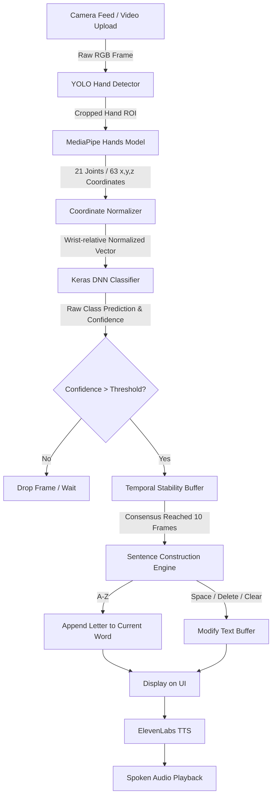

# 🤟 Signal: Real-Time Sign Language Recognition & Speech Synthesis System
**Author:** Pavan Doddavarapu  
**Live Demo:** [Hugging Face Spaces](https://huggingface.co/spaces/pavandoddavarapu/signal) | **Code Repository:** [GitHub](https://github.com/pavandoddavarapu/signal)

---

## 📌 Executive Summary / Project Overview

**Signal** is an end-to-end, deep-learning-powered assistive communication platform that translates American Sign Language (ASL) fingerspelling and dynamic control gestures into structured English text and natural, audible human speech in real-time. 

Operating seamlessly in standard web browsers with commodity webcams, Signal bridges the accessibility divide between Deaf/Hard-of-Hearing individuals and non-signing communities without requiring expensive sensory gloves, depth sensors, or high-end GPU workstations.

---

## 🎯 What This Project Does

1. **Vision-Based Hand Localization:** Detects the user's hand within dynamic, cluttered backgrounds using a custom YOLOv8 detector.
2. **Geometric Landmark Extraction:** Extracts 21 key hand joints in 3D coordinate space $(x, y, z)$ using MediaPipe, decoupling sign recognition from lighting, skin tone, camera distance, and background noise.
3. **High-Accuracy Classification:** Processes 63 invariant geometric features through a Deep Neural Network (DNN) classifier built in TensorFlow/Keras to identify 26 ASL alphabet signs ($A-Z$) and 3 text-composition control gestures (**Space**, **Delete**, **Clear**).
4. **Temporal Stability Filtering:** Uses a rolling consensus buffer (10-frame window) to filter frame-to-frame noise and transition artifacts.
5. **Interactive Sentence Builder:** Assembles recognized letters into meaningful words and phrases.
6. **Voice Synthesis (TTS):** Converts finalized text sentences into human speech using the ElevenLabs Voice API.
7. **Dual-Input Interface:** Supports both **Live Camera Translation** (via WebRTC) and **Pre-recorded Video Upload** analysis.

---

## 🛠️ Complete Tech Stack

| Layer | Technologies Used | Purpose / Role |
| :--- | :--- | :--- |
| **Frontend / Web UI** | Streamlit, Streamlit-WebRTC, HTML5, Vanilla CSS | Reactive web dashboard, webcam streaming, video upload, audio playback |
| **Object Detection** | Ultralytics YOLOv8 (`yolo_best_weights.pt`) | Hand detection & region-of-interest (ROI) cropping |
| **Landmark Extraction** | Google MediaPipe Hands | 21 hand landmarks (63 normalized 3D features) |
| **Classifier Model** | TensorFlow 2.17 / Keras (`landmark_model.keras`) | Dense Neural Network classifying geometric feature vectors |
| **Legacy Architecture** | PyTorch (`landmark.pt`) | Initial baseline prototype |
| **Voice Synthesis** | ElevenLabs Python SDK & REST API | Ultra-realistic Text-to-Speech (TTS) |
| **Computer Vision** | OpenCV (`opencv-python`), PyAV (`av`) | Frame capture, color space conversion, BGR-to-RGB formatting |
| **Data & Math** | NumPy, Pandas, Plotly | Matrix manipulation, feature normalization, training metric visualization |
| **Deployment** | Hugging Face Spaces (Git LFS), GitHub, Streamlit Cloud | Cloud hosting, model tracking, and distribution |

---

## 🚀 Steps of Development (The Engineering Journey)

### Stage 1: The Raw YOLO Attempt (Direct Object Detection)
* **Goal:** Detect each sign directly from image pixels using YOLO.
* **Problem Encountered:** Visually similar signs (e.g., $M$ vs $N$, $A$ vs $S$, $U$ vs $V$) suffered high error rates due to skin-tone variations, angles, lighting, and background interference.

### Stage 2: Paradigm Shift — Semantic Geometry over Raw Pixels
* **The Solution:** Rather than classifying millions of pixels, transform the hand into an appearance-independent geometric skeleton of 21 landmark points ($x, y, z$).
* **Outcome:** Drastically reduced training time and eliminated background/lighting bias.

### Stage 3: Two-Stage Hybrid Pipeline (YOLO + MediaPipe + Keras)
* **YOLO's New Role:** YOLO localizes the hand in the wide camera frame and crops the Region of Interest (ROI).
* **MediaPipe's Role:** MediaPipe extracts the 21 joints from the isolated hand ROI.
* **Keras Classifier:** A dedicated 4-layer fully connected neural network classifies the 63 normalized coordinates into 29 classes ($A-Z$ + Space + Delete + Clear) with **95.02% validation accuracy**.

### Stage 4: Composition Controls & Stability Engineering
* Isolated letters are not enough to communicate. We engineered:
  - **Space Gesture:** Adds word separations.
  - **Delete Gesture:** Backspaces typos.
  - **Clear Gesture:** Resets the workspace.
  - **Temporal Consensus Buffer:** Prevents transient letters from entering the word during hand repositioning.

### Stage 5: Speech Synthesis & WebRTC Deployment
* Integrated ElevenLabs API for voice generation.
* Deployed on Streamlit with custom WebRTC video loop handling.

---

## 🔄 End-to-End Processing Steps (How It Works)



### Detailed Pipeline Flow:
1. **Frame Ingestion:** Video frames are grabbed at 30 FPS from either WebRTC or disk.
2. **Bounding Box Localization:** YOLO identifies the hand coordinates $[x_{min}, y_{min}, x_{max}, y_{max}]$ with confidence padding.
3. **Landmark Extraction:** MediaPipe extracts 21 Cartesian landmarks $(x, y, z)$.
4. **Feature Normalization:** Coordinates are normalized relative to Landmark 0 (wrist origin) and scaled by hand span.
5. **Inference:** The 63-element feature vector passes through `landmark_model.keras` producing a softmax probability vector across 29 classes.
6. **Consensus Buffer:** Predictions enter a queue of length $N$ (default: 10). Only when $\ge 80\%$ of recent frames agree does the system register a character.
7. **Sentence Construction:** Letters are formed into words; control signs modify sentences in real-time.
8. **TTS Audio:** Audio is synthesized into natural speech and streamed back to the user.

---

## 📊 Dataset & Class Distribution

The vocabulary consists of **29 total classes**:
* **26 Alphabetic ASL Signs:** $A, B, C, D, E, F, G, H, I, J, K, L, M, N, O, P, Q, R, S, T, U, V, W, X, Y, Z$
* **3 Functional Control Gestures:**
  - **Space:** Insert word break
  - **Delete:** Remove previous character
  - **Clear:** Erase entire sentence

---

## 💻 How to Run Locally

### 1. Prerequisites
* Python 3.10 - 3.12
* Git and Git LFS installed

### 2. Clone Repository
```bash
git clone https://github.com/pavandoddavarapu/signal.git
cd signal
```

### 3. Install Dependencies
```bash
pip install -r requirements.txt
```

### 4. (Optional) Set Voice API Key
Create a `.env` file in the root directory:
```bash
cp .env.example .env
```
Add your ElevenLabs API Key:
```env
ELEVENLABS_API_KEY="your_api_key_here"
```

### 5. Launch Application
```bash
streamlit run app/main.py
```
Open **[http://localhost:8501](http://localhost:8501)** in your browser.

---

## 🎤 Presentation & Defense Quick Guide (For Interviews & Reviews)

### 1. Elevator Pitch (30 Seconds)
> *"Signal is a real-time computer vision system that translates American Sign Language gestures directly into spoken voice. Rather than using brute-force pixel classification, our system isolates hand geometry into 21 joints, pairs YOLO for localization with a high-speed Keras classifier, and features interactive control gestures and AI speech synthesis."*

### 2. Key Technical Advantages to Highlight
* **Appearance Invariant:** Extracts landmarks so skin color, lighting conditions, and camera differences do not degrade classification.
* **Low Latency & High FPS:** Feature vectors are only 63 floating-point numbers, allowing inference in $<5$ ms per frame even on standard CPU laptops.
* **Complete Product Pipeline:** Not just a model — it includes sentence building, gesture deletion, consensus filtering, and audio synthesis.

---

## 📜 License
Distributed under the MIT License. Copyright (c) 2026 Pavan Doddavarapu.
